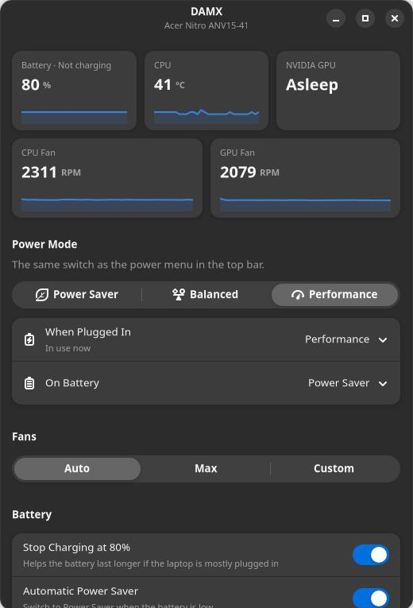
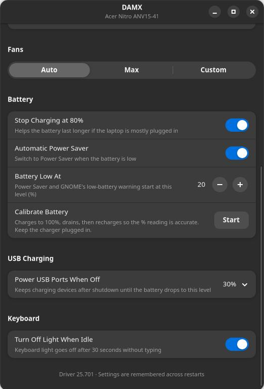

# DAMX — nitro-gnome fork

A personal fork of [Div Acer Manager Max](https://github.com/PXDiv/Div-Acer-Manager-Max),
rebuilt for one laptop: an **Acer Nitro ANV15-41 on Ubuntu 26.04 with GNOME 50**.
It controls the battery charge limit, fans, power modes, USB charging and keyboard
backlight, and it plays nicely with GNOME instead of fighting it.

<p align="center">
  
  
</p>

## Features

- **Live stat cards:** battery, CPU temperature, NVIDIA GPU temperature and load,
  and both fan speeds in RPM, each with a graph of the last minute. Tap a card to
  jump to its settings.
- **Power mode = GNOME's power mode.** Power Saver / Balanced / Performance in the app
  is the same switch as the power menu in the top bar, and it really changes the Acer
  firmware mode (fans and power limits), not just the CPU.
- **One mode for plugged in, one for battery.** Plugging in or unplugging switches to
  the mode you last used in that state. GNOME's automatic low-battery Power Saver
  never overwrites your choice.
- **Everything is remembered** across restarts: 80% charge limit, fan mode, USB
  charging when off, and keyboard light timeout.
- **Battery low level:** choose when GNOME's Automatic Power Saver and low-battery
  warning kick in (10–50%).
- **Fans:** Auto, Max, or Custom with separate CPU and GPU sliders.
- **Nitro key** opens the app.
- **Survives kernel updates:** the driver is installed with DKMS and rebuilds itself.
- **Battery friendly:** the NVIDIA card is only read while the GPU is already awake,
  and the app backs off when the GPU is idle so it can go back to sleep.

## What's different from upstream DAMX

| Upstream DAMX | This fork |
|---|---|
| Driver breaks after every kernel update | Driver installed with **DKMS**, rebuilt automatically |
| GNOME's power menu only changed the CPU; DAMX changed the firmware mode separately, so the two disagreed | The driver reports the modes GNOME expects, so **GNOME's power menu drives the Acer firmware modes** and the app uses that same switch |
| Settings forgotten after a reboot | `damxd` remembers and restores them at boot |
| Switched modes on its own on AC/battery and forgot your choice | Remembers **your** mode for plugged in and for battery |
| Performance on battery failed with an error | Runs Balanced while on battery (firmware limit) and switches to Performance when you plug in |
| 100 MB .NET GUI | Small GTK4 + libadwaita app that matches GNOME, light and dark |

## How it fits together

```
driver/   linuwu_sense kernel driver (from PXDiv/Div-Linuwu-Sense, patched) + dkms.conf
daemon/   damxd.py - root service: remembers settings and modes, Nitro key,
          battery low level, socket for the app (/run/damx.sock)
app/      damx.py  - the GTK4/libadwaita app, launcher entry and icon
install.sh / uninstall.sh
```

- **Power mode** goes through GNOME's `power-profiles-daemon`, both from the app and from `damxd`.
- **Hardware settings** go through `damxd`, which writes them to the driver and saves
  them in `/var/lib/damx/`.
- **Battery low level** is `PercentageLow` in `/etc/UPower/UPower.conf`. `damxd`
  edits it and keeps the original as `UPower.conf.damx-orig`.

## Install / update

```bash
sudo ./install.sh
```

Needs `dkms`, kernel headers, `python3-gi`, `gir1.2-adw-1` (libadwaita 1.7+) and
`python3-evdev`. All of these were already installed on Ubuntu 26.04.

The installer also removes the original DAMX 1.0.2 install (`/opt/damx`,
`damx-daemon.service`, and the loose driver files under `/lib/modules`). To remove
this fork, run `sudo ./uninstall.sh`.

## Credits

Driver: Linuwu-Sense by 0x7375646F, modified by PXDiv (Div Sharp) for DAMX, based on
the kernel `acer-wmi` driver. Original DAMX by PXDiv. Licensed GPL-3.0 (see `LICENSE`).
